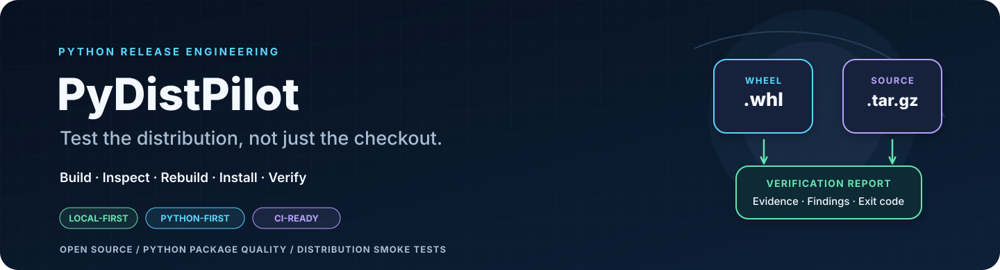
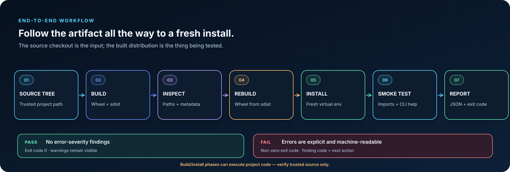
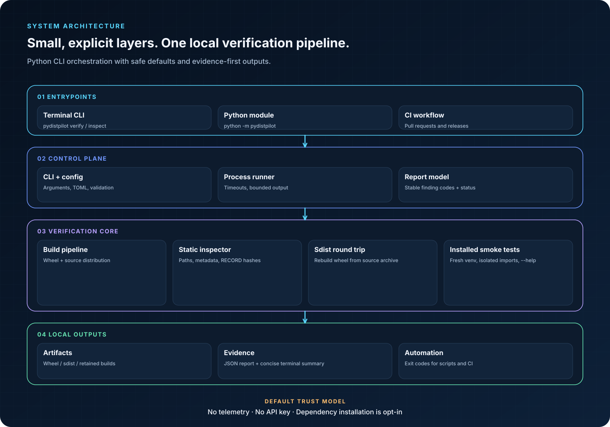
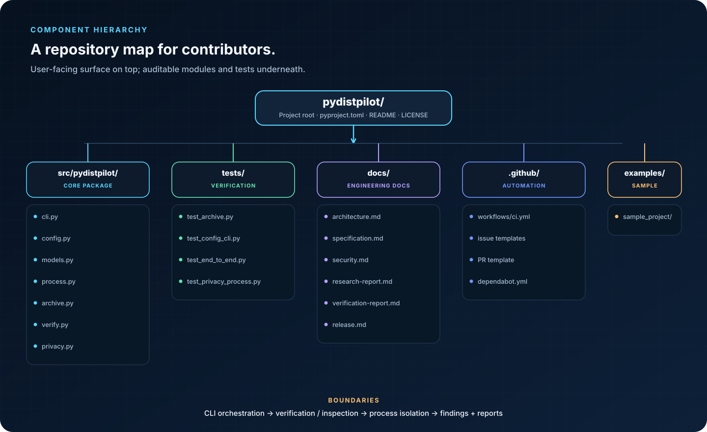
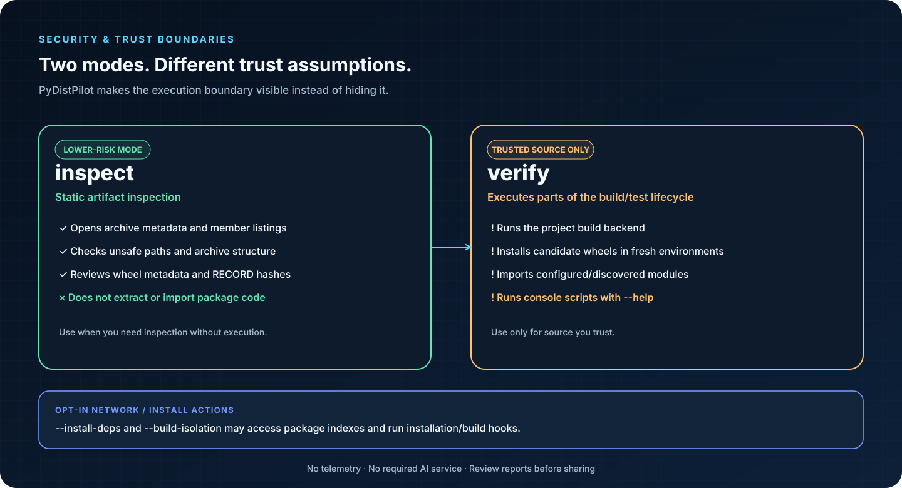

# PyDistPilot



**Test the distribution, not just the checkout.**

<p align="center">
  
</p>

PyDistPilot is a local-first Python release-verification CLI. It builds a wheel and source distribution, audits archive paths and package metadata, rebuilds a wheel from the source distribution, then installs built wheels into fresh virtual environments and smoke-tests configured/import-discovered modules and console-script `--help` commands.

It is designed for the gap between “the tests pass in my repository” and “the artifact that users install actually imports and starts.” It complements `pytest`, `build`, `twine`, `check-wheel-contents`, `tox`/`nox`, and provenance/signature tools; it does not replace them.

- **Python-first and local-first.** Runtime logic uses Python and the standard library (Python 3.10 uses the small `tomli` backport for TOML parsing).
- **Offline by default.** Dependency installation is disabled by default, and builds use the already-installed build backend unless you explicitly request build isolation.
- **Artifact-first.** Checks the wheel produced from the source tree and the wheel rebuilt from the sdist, not only the editable/source checkout.
- **Fresh-environment smoke checks.** Runs import tests with isolated Python (`-I`) from an empty working directory and checks console-script `--help` entry points.
- **Static artifact inspection.** `inspect` parses wheel/sdist metadata and paths without installing or executing the artifact.
- **Actionable, machine-readable results.** Stable finding codes, recommendations, bounded output capture, JSON reports, and nonzero exit status on errors.
- **SARIF 2.1.0 export.** Emit findings for compatible code-scanning and security-analysis tools; paths outside the project are reduced to basenames to avoid exposing unrelated filesystem paths.
- **Regression-aware report comparison.** Compare a candidate JSON report with an accepted baseline, detect new/resolved findings, and fail CI only for newly introduced warnings/errors by default.
- **Safe report handling.** Report outputs are written atomically, reject symbolic-link targets, and refuse to overwrite existing project files; existing PyDistPilot reports can be refreshed.
- **No telemetry, no API keys, no service.** Nothing is uploaded by the tool.


## Visual tour

### How verification works



The full pipeline follows the artifacts rather than trusting the source checkout alone. See the [editable Mermaid workflow](docs/diagrams/workflow.mmd).

### Architecture



The CLI coordinates explicit components: build and process execution, archive inspection, installed-artifact smoke checks, and report generation. See [architecture documentation](docs/architecture.md) and the [editable Mermaid architecture](docs/diagrams/architecture.mmd).

### Repository and contributor hierarchy



Start with `src/pydistpilot/` for implementation, `tests/` for behavior and regression coverage, and `docs/` for technical decisions and verification evidence.

### Security boundaries



`inspect` parses archive contents without importing package code. `verify` runs the trusted project's build backend and smoke checks. Network-facing build isolation and dependency installation remain explicit opt-ins. See the [security model](docs/security.md) and [editable Mermaid trust-boundary diagram](docs/diagrams/security-boundaries.mmd).

All README illustrations are local SVG files—no externally hosted image or tracking pixel is required. The [diagram catalog](docs/diagrams/diagram-catalog.json) contains a machine-readable index of the visuals and their intent.


> **Security boundary:** `pydistpilot inspect` is the static-only command. `pydistpilot verify` executes your project's build backend and imports package code and console entry points from the artifacts it built. Use `verify` only with source you trust. `--build-isolation` can download build requirements; `--install-deps` can access package indexes and run dependency installation. Neither is enabled by default.

## Quick start

PyDistPilot `0.2.0` is currently an alpha release candidate and has **not** been published to PyPI. Use Python 3.10–3.14. From a checkout of this repository, install the CLI and its build tooling into a virtual environment:

```bash
python -m venv .venv
# Windows PowerShell: .venv\Scripts\Activate.ps1
# macOS/Linux: source .venv/bin/activate
python -m pip install -e ".[build]"
python -m pydistpilot verify examples/sample_project
```

To verify another trusted project, pass its path to `verify`:

```bash
pydistpilot verify path/to/your-python-project
```

After PyDistPilot is actually published to PyPI, the equivalent installer will be `python -m pip install "pydistpilot[build]"`. Do not use that command until the package is available from your package index.

For the strongest zero-configuration result, configure one or more import roots (see below). The verifier discovers regular top-level packages and modules from the wheel when this setting is absent, but automatic discovery cannot reliably infer arbitrary namespace-package intent.

Example console summary:

```text
PyDistPilot 0.2.0 · /work/my-library
========================================================================
Status: PASSED | 3 artifact(s) | 6 smoke check(s) | 0 error(s) | 0 warning(s)

Artifacts
  [OK  ] wheel: my_library-2.4.0-py3-none-any.whl (... bytes)
  [OK  ] sdist: my_library-2.4.0.tar.gz (... bytes)
  [OK  ] wheel: my_library-2.4.0-py3-none-any.whl (... bytes)

Installed-artifact smoke checks
  [PASSED] wheel-install: wheel-0 (...s) — Installed into a fresh virtual environment.
  [PASSED] import: my_library (...s) — Imported from the installed environment.
  [PASSED] console-script: my-library (...s) — --help returned exit status 0.
```

The sample output is illustrative; actual artifact names, durations, and check counts depend on your project.

## SARIF output and regression gates

Export Static Analysis Results Interchange Format (SARIF) alongside a normal verification report:

```bash
pydistpilot verify . --report baseline.json --sarif verification.sarif
pydistpilot inspect dist/*.whl --json inspection.json --sarif inspection.sarif
```

Compare a new report with an accepted baseline in CI. The command returns a non-zero exit code for newly introduced errors or warnings; new informational findings are reported but do not block by default.

```bash
pydistpilot verify . --report candidate.json --sarif candidate.sarif
pydistpilot compare baseline.json candidate.json --json regressions.json --sarif regressions.sarif
```

Use `--fail-on-current-failure` when policy requires the candidate report to pass completely, including pre-existing failures. Baseline comparison intentionally ignores path and evidence changes when matching an issue, so temporary workspaces do not create spurious regressions. Treat baseline files as reviewed policy inputs: accepting a baseline that contains failures can suppress those existing issues from the regression gate.

SARIF and JSON output files must use different paths. Report comparison accepts regular files containing PyDistPilot schema-version-1 `verify`/`inspect` reports up to 16 MiB each. It rejects malformed or unsupported schemas and prior comparison outputs rather than silently interpreting them. Example output files are included in [`docs/reports/`](docs/reports/), including [verification SARIF](docs/reports/sample-verification.sarif), [static inspection SARIF](docs/reports/artifact-inspection.sarif), and an explicitly synthetic regression result.

To exercise the comparison command against the included synthetic warning fixture, run:

```bash
pydistpilot compare docs/reports/comparison-baseline.example.json docs/reports/comparison-candidate.synthetic.json --json comparison.json --sarif comparison.sarif
```

This example is **expected to return exit code 1** because the candidate contains a deliberately synthetic new warning. It is demonstration data, not a report from a real package defect.

## Configure import smoke targets

Add import roots used by your public API to the repository's `pyproject.toml`:

```toml
[tool.pydistpilot]
imports = ["my_library", "my_library.public_api"]
```

Or override targets for a single run:

```bash
pydistpilot verify . --import my_library --import my_library.public_api
```

When at least one `--import` flag is provided, the command-line targets override project configuration. Import checks run with the isolated interpreter flag and from an empty working directory to reduce accidental imports from the source checkout.

## Retain release artifacts or create a JSON report

```bash
pydistpilot verify . --keep-artifacts ../my-library-release-candidate --report ./pydistpilot-report.json
```

`--keep-artifacts` requires a new or empty directory **outside the project directory**. It will not overwrite existing artifact files. The report contains artifact hashes, outcomes, findings, timing, and redacted/truncated failure evidence. It does not upload artifacts anywhere.

Reports include the project path and may contain local paths or redacted command output in findings. Secret redaction is best-effort, not a guarantee; review JSON reports before sharing them publicly.

Use dependency resolution only when required and expected:

```bash
pydistpilot verify . --install-deps
```

This may access your configured package index and install/execute dependency code. A build backend that needs additional dependencies can be run in an isolated environment with `--build-isolation`; that can also download packages.

## Static inspection without execution

Use this for artifacts from a source or publisher you do not trust. PyDistPilot will parse archive metadata and inspect archive paths, without extraction, imports, build commands, or installation:

```bash
pydistpilot inspect dist/*.whl dist/*.tar.gz
pydistpilot inspect dist/*.whl --json pydistpilot-inspection.json
```

The static inspector checks path safety, archive integrity, key metadata, wheel structure, and wheel `RECORD` hashes. It is **not** a malware scanner, does not establish artifact provenance, and does not prove that the source repository matches a published artifact.

## Commands

| Command | Purpose | Executes package code? |
|---|---|---|
| `pydistpilot verify [PROJECT]` | Build wheel + sdist, audit them, rebuild a wheel from the sdist, install into isolated environments, smoke-test imports and console scripts | **Yes** |
| `pydistpilot inspect ARTIFACT...` | Static inspection of existing `.whl` and supported source archives | No |
| `pydistpilot compare BASELINE CANDIDATE` | Detect new and resolved findings between two schema-v1 JSON reports | No |
| `pydistpilot --version` | Print version | No |

Important flags: `--import MODULE` (repeatable), `--timeout SECONDS` (>0 to 3600; default 90 per build/install/smoke command), `--install-deps` (explicit dependency resolution), `--build-isolation` (isolated build dependencies), `--keep-artifacts DIR`, `--report JSON`, `--json JSON`, `--sarif SARIF`, `--fail-on-current-failure`, and `--quiet`.

## Exit codes

- `0`: verification/inspection completed without error-severity findings.
- `1`: verification failed or the static inspector found errors.
- `2`: CLI/report-output error.

Warnings do not fail the command. A report's `schema_version` is currently `1`.

## Development and quality checks

From the repository root, install the development extra and run the same local gates used by CI:

```bash
python -m pip install -e ".[dev]"
python -m pytest -q
ruff check src tests
mypy src/pydistpilot
python -m build --no-isolation
python -m twine check dist/*
```

The external lint, type, metadata, and vulnerability gates are configured in CI but were not all executable in the offline authoring environment. See the [verification report](docs/verification-report.md) for exact results and limitations. In an offline environment without build tooling, the runtime/CLI path can still be exercised with `python -m pydistpilot --help` from the source checkout; distribution builds require the configured PEP 517 backend and its build requirements.

## Troubleshooting

**`No module named build` or build step fails immediately.** From the PyDistPilot repository, install `python -m pip install -e ".[build]"` or the development extra. Once published to your configured package index, `pydistpilot[build]` is the corresponding installed-project extra. The verifier deliberately does not download its own tooling.

**Import test fails because a dependency is absent.** The default path installs the project artifact with `--no-deps --no-index`. Inspect declared dependencies first; if network package resolution is appropriate for this trusted project, rerun explicitly with `--install-deps`.

**A namespace package was not discovered.** Set its import root in `[tool.pydistpilot].imports` or use `--import`.

**`--help` for a console script fails.** This is a real smoke failure, but some custom commands intentionally do not support `--help`. Correct the entry point or do not expose it as a console-script entry point if it cannot satisfy the conventional help invocation. A future version may introduce an explicit per-command opt-out.

**The build says a backend dependency is missing.** PyDistPilot defaults to `--no-isolation` to avoid network access. Install the project's declared build requirements into the current interpreter first, or choose `--build-isolation` when downloading build dependencies is permitted.

**A build or CLI command timed out.** Inspect the reported phase. Raise `--timeout` only when the operation is legitimately expected to take longer; the timeout is applied separately to each external step.

## Scope and known limitations

- PyDistPilot is an early-stage verification aid, not a release guarantee. A passing smoke check does not establish complete behavioral correctness, API compatibility, security, or provenance.
- It uses the currently selected Python interpreter for the build and smoke environments; it does not run a cross-version/OS matrix itself. Use CI to verify every supported environment.
- Dependencies are not installed by default. Packages that require dependencies to import may need an explicit `--install-deps` run or future configured offline wheelhouse support.
- Static archive checks use size/member limits and do not extract source archives. Package managers/build backends still perform their normal archive handling during a trusted `verify` run.
- Import discovery can be ambiguous for namespace packages, generated modules, or packages with multiple import roots.
- Console entry points are automatically called with `--help`; unusual commands may need future configuration controls.
- The build's reproducibility is not measured byte-for-byte. No attestation, signature, malware, vulnerability, or provenance verification is performed.
- `--install-deps` may use network indexes and execute install/build hooks. Dependency installation is a separate trust decision.

## Documentation

- [Research report and concept evaluation](docs/research-report.md)
- [Product specification and acceptance criteria](docs/specification.md)
- [Architecture and data flow](docs/architecture.md)
- [Security model and residual risks](docs/security.md)
- [Release checklist and demo plan](docs/release.md)
- [Verification report and unrun gates](docs/verification-report.md)
- [SARIF and baseline-comparison design](docs/reporting-and-baselines.md)
- [PyPI Trusted Publishing setup](docs/publishing.md)
- [Changelog](CHANGELOG.md)
- [Contribution guide](CONTRIBUTING.md)
- [Security reporting policy](SECURITY.md)


## Related Python packaging workflows

PyDistPilot is relevant to **Python package verification**, **Python packaging CLI** workflows, **wheel and sdist validation**, **Python distribution testing**, **installed-package smoke testing**, **release artifact inspection**, **PyPI release preflight**, and **CI/CD packaging checks**. It is intended to complement build, test, lint, metadata-check, and provenance tools—not to replace them or certify a release on its own.

## License

MIT. See [LICENSE](LICENSE).

## CI and release status

This repository is public and the default branch contains the full PyDistPilot 0.2.0 source tree. The CI badge at the top points to the live GitHub Actions workflow. Do not treat version 0.2.0 as stable until the Python/OS matrix, lint, type checks, distribution metadata checks, and dependency audit complete successfully. Hosted results may differ from local verification; use the workflow run attached to the exact commit you plan to release.

The `publish.yml` workflow is prepared for tag-based PyPI Trusted Publishing, but publication also requires configuring the PyPI Trusted Publisher for this repository and the `pypi` environment. No PyPI publication is implied by the existence of that workflow.
