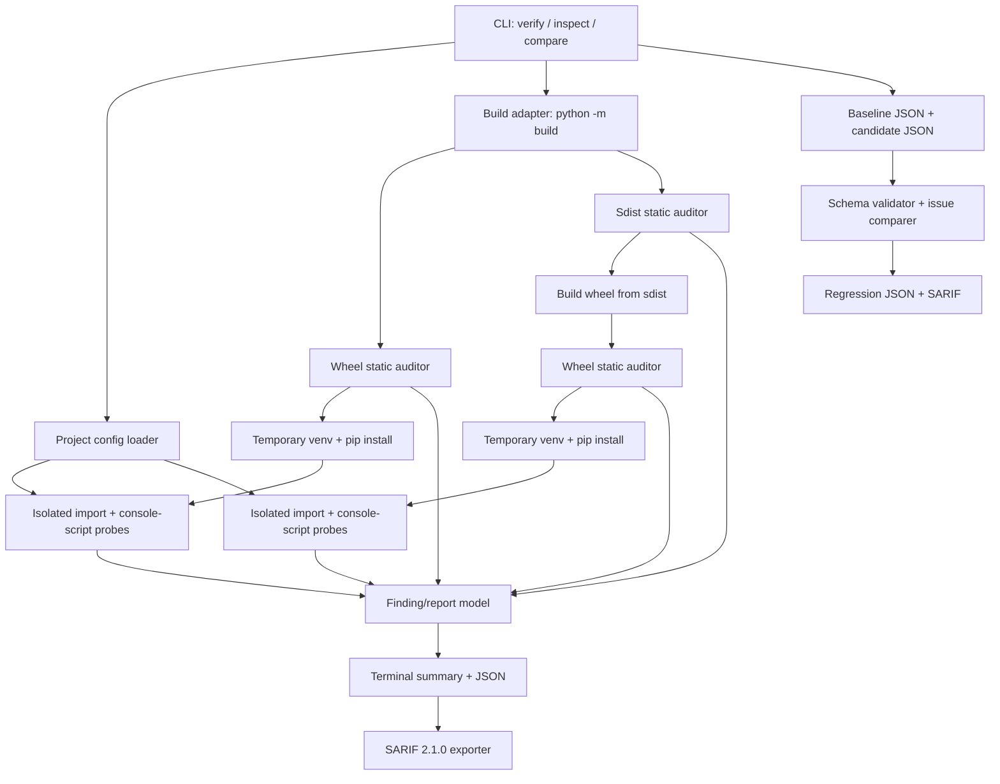

# Architecture and design decisions

## Component view

## Modules

- `cli.py`: argument parsing, presentation, atomic JSON output, SARIF/JSON output routing, baseline comparison, exit codes.
- `config.py`: reads only `[tool.pydistpilot].imports` from `pyproject.toml`; rejects malformed targets.
- `process.py`: starts processes without a shell, enforces a timeout, drains stdout without unbounded in-memory capture, limits stored output, and redacts common credential patterns before storing diagnostic excerpts.
- `archive.py`: statically inspects ZIP/TAR members, checks path and size limits, reads core metadata, validates wheel `RECORD` payload hashes/sizes, infers visible import roots, and extracts console-script names. During `verify` only, it also safely extracts an already-audited sdist into a temporary directory for the required wheel rebuild; `inspect` never extracts archives.
- `verify.py`: orchestrates build, static inspection, source archive rebuild, isolated installation, smoke checks, and report creation.
- `models.py`: typed report and finding structures; `schema_version` makes report evolution explicit.
- `comparison.py`: validates schema-v1 reports, counts stable finding identities, reports new/resolved findings, and enforces regression exit policy. JSON inputs are capped at 16 MiB each.
- `reporting.py`: creates SARIF 2.1.0; retains stable rule IDs and fingerprints while avoiding local `file://` URIs and redacting absolute paths to safe relative paths or basenames.
- `privacy.py`: best-effort redaction for common tokens/assignments. It is not a complete secret detector.

## Data flow

1. The user invokes `verify PROJECT` or `inspect ARTIFACT...`.
2. `inspect` reads artifact metadata directly and never launches a build/install/import process or extracts an archive.
3. `verify` executes the configured build backend, placing candidate files in a fresh temporary folder by default.
4. It reads archive metadata and member listings with archive APIs. For valid wheels it computes hashes from the actual member bytes and compares them to RECORD.
5. After static checks pass, `verify` safely extracts the sdist to a fresh temporary directory, validating path/type/size/duplicate constraints again, then rebuilds a wheel from that extracted project tree.
6. It creates fresh venvs; pip is invoked with `--no-index --no-deps` unless `--install-deps` is explicitly enabled.
7. Smoke probes run from a temporary empty directory using isolated Python mode; the report stores outcomes, not full unbounded logs.
8. Temporary artifacts/environments are deleted unless the user explicitly requests retention of original built artifacts. JSON reports preserve detailed verification evidence; SARIF exports stable rules and findings with safer path handling.
9. `compare` accepts a previously reviewed schema-v1 baseline and a candidate report, then returns a new/resolved-finding summary with CI-friendly status and optional SARIF.

## Design decisions

### D1: Verify artifacts, don't replace build backends

PyDistPilot delegates PEP 517 builds to `python -m build` instead of attempting to implement build backend hooks. Backend versions and build dependencies are project-specific.

### D2: Offline/no-deps by default

The first smoke phase installs only the produced wheel with `--no-index --no-deps`. This makes the check useful without silent dependency downloads. It also means imports that require third-party dependencies may fail until the user explicitly opts into `--install-deps` or a later offline-wheelhouse feature exists.

### D3: Install rather than import from source

The smoke venv is fresh, import uses `-I`, and the working directory is empty. The module origin must resolve within the venv; this helps detect accidental local-checkout imports.

### D4: Read-only archive inspection

Static mode does not extract files from a candidate artifact. It validates path shapes, duplicate names, declared sizes, ZIP CRCs, metadata placement, and wheel RECORD. `verify` later asks normal packaging tools to build/install a project artifact only when the user runs it on source they trust.

### D5: Bounded subprocess evidence

Commands are arrays, never shell strings. Child output is drained so it cannot deadlock on full pipes; in-memory stored output is capped and redacted before reporting. Every external command has a timeout. POSIX process groups are killed on timeout; Windows uses best-effort `taskkill /T` with a direct-child fallback. The tool does not guarantee complete redaction for arbitrary secrets.

### D6: Findings are evidence, not causal certainty

A failed import is reported as a failed import; PyDistPilot does not claim it has found the underlying root cause. Each finding includes a stable code and remediation suggestion.

### D7: Static analysis is a separate path

`inspect` exists so users can inspect artifacts they do not trust. It does not establish authenticity; use provenance/signature tools for that purpose.

## Failure handling

- Build, sdist rebuild, install, import, CLI, and report-output failures are distinguished by finding codes.
- Timeout failures state which phase exceeded the limit.
- Invalid/missing project paths and malformed config stop early.
- An archive that exceeds declared size/member limits is flagged. Resource guards should not be considered a perfect defense against every parser or compression-library flaw.
- Warnings do not fail exit status, but error-level archive/smoke findings do.

## Extendability

Report-format adapters remain separate from the audit core. SARIF 2.1.0 and report-baseline comparison are implemented as local capabilities without requiring a service. A future GitHub job-summary adapter, configurable smoke commands, offline dependency wheelhouses, and multi-Python execution should be added only with explicit security boundaries and tests.
